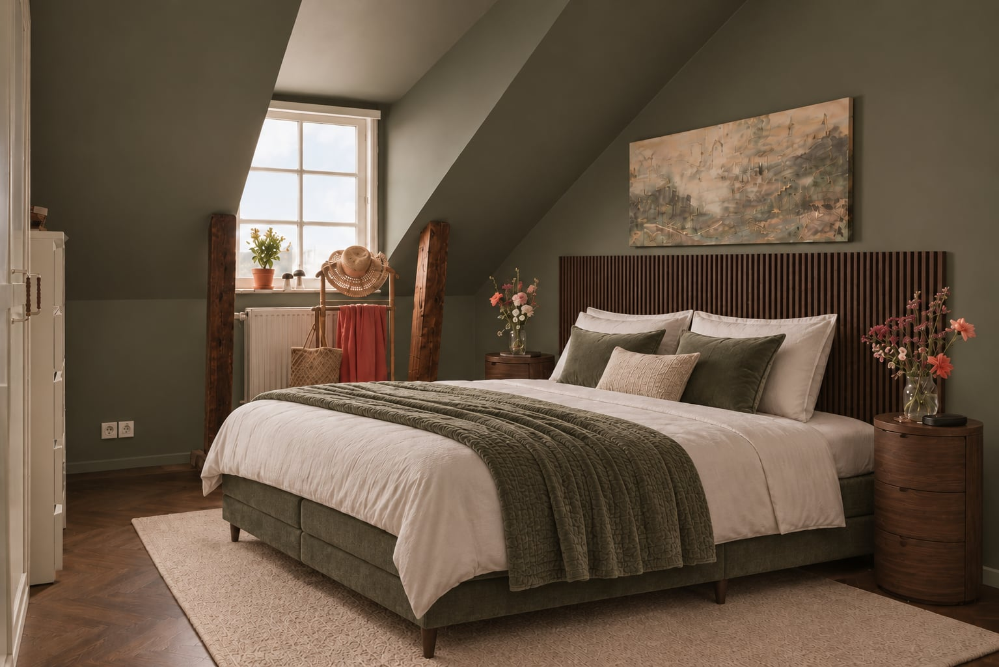
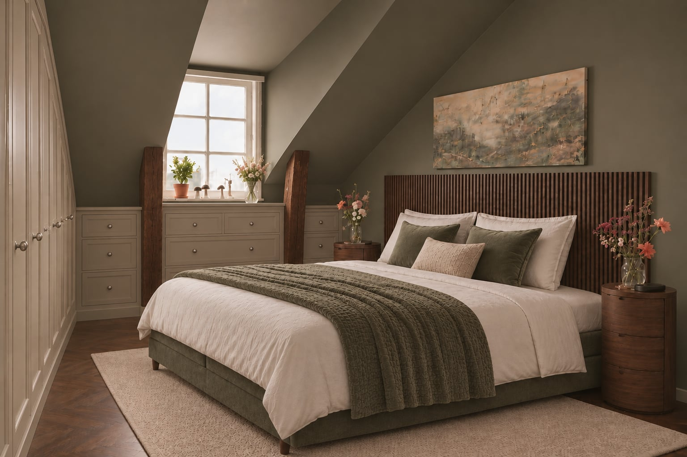

# Sovrum

Status: Utforskas
Prioritet: Medium

## Mal

Skapa ett lugnt och ombonat sovrum med genomtankt forvaring under snedtaket.

## Inspiration

Tva forslag visar samma dova gron-gra fargskala, sanggavel i morkt tra och mjuka textilier. Det ena har fristaende mobler vid fonstret; det andra bygger in forvaringen langs vaggen och under fonstret.

## Fragor

- Hur mycket garderobsforvaring behovs?
- Ska forvaringen byggas in eller losas med fristaende mobler?
- Vilken belysning passar vid sangen och under snedtaket?

## Uppgifter

| Uppgift | Agare | Timing | Status | Anteckningar |
| --- | --- | --- | --- | --- |
| Mata sovrum, snedtak och fonster | Du | 2026-12-21 | Schemalagd | Dokumentera fri hojd, djup och elementets placering. |
| Bestam forvaringslosning | Bada | Efter mattagning | Backlog | Jamfor platsbyggt med fristaende garderober. |

## Budget

| Post | Estimat | Offert / Utfall | Anteckningar |
| --- | ---: | ---: | --- |

## Beslut

| Beslut | Alternativ | Behovs Senast | Utfall |
| --- | --- | --- | --- |

## Referenser

- Bilderna pa [sovrumsprojektets sida](../projects/sovrum.html).
